## Hi! 
## tech stack

<!-- Languages -->

<!-- Frameworks -->

<!-- Databases -->

<!-- Tools -->

 
##  GitHub Activity Graph

  

  

## GitHub Metrics

  

<!--
**MerabtiMeriem/MerabtiMeriem** is a ✨ _special_ ✨ repository because its `README.md` (this file) appears on your GitHub profile.
Here are some ideas to get you started:
- 🔭 I’m currently working on ...
- 🌱 I’m currently learning ...
- 👯 I’m looking to collaborate on ...
- 🤔 I’m looking for help with ...
- 💬 Ask me about ...
- 📫 How to reach me: ...
- 😄 Pronouns: ...
- ⚡ Fun fact: ...
-->
